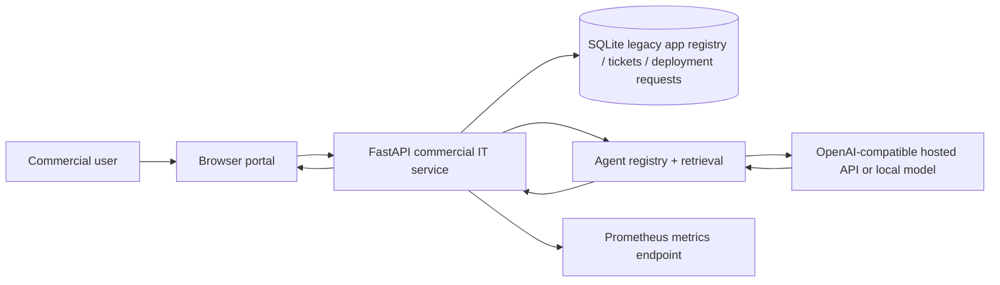

# POC system architecture

Legacy path remains functional without model. POC identity is not trusted. Production path must add verified OIDC, per-tenant authorization, secrets and auditable boundaries.
