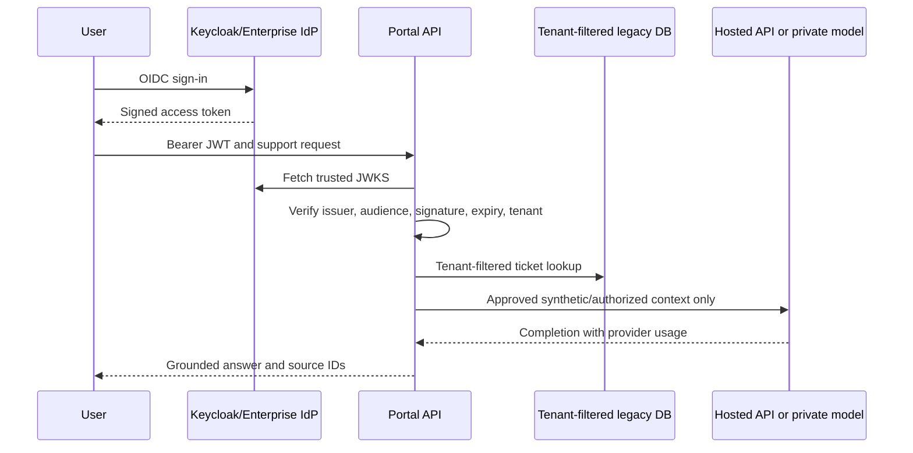

# Identity, requests and model data boundaries

Hosted model call explicitly sends selected context outside customer's network. Private vLLM requires GPU node, model license, private service and checked network policies.
